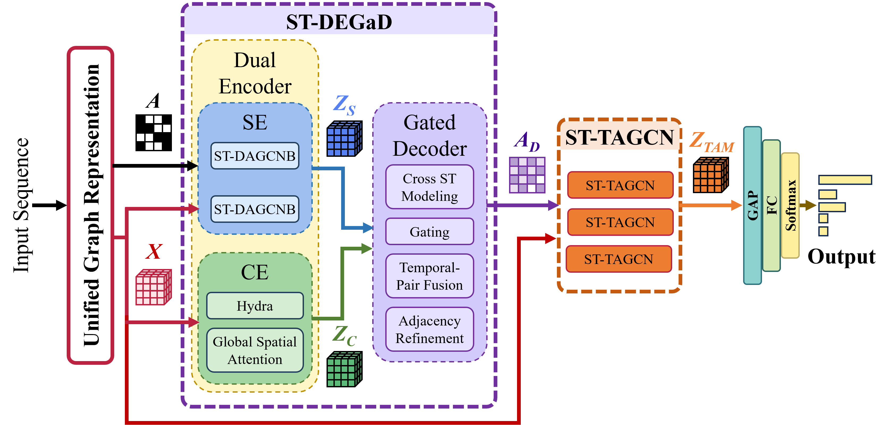

# Learning Where to Propagate and What to Emphasize: Unified Spatio-Temporal Graph Learning for Human-Centric Data

**Shayhan Ameen Chowdhury**<sup>1</sup>, **Md Azher Uddin**<sup>2</sup>, and **Young-Koo Lee**<sup>3,\*</sup>

<sup>1</sup> Department of Computer Science and Engineering, Kyung Hee University, Global Campus, Yongin 17104, Korea
<sup>2</sup> Department of Computer Science, Heriot-Watt University Dubai Campus, Dubai 501745, United Arab Emirates
<sup>3</sup> Department of Artificial Intelligence, Kyung Hee University, Global Campus, Yongin-si, Republic of Korea
<sup>\*</sup> Corresponding author

This repository contains the PyTorch implementation of the unified spatio-temporal graph learning framework (ST-DEGaD + ST-TAGCN) for facial expression recognition, EEG-based epileptic seizure detection, and skeleton-based human action recognition.

<p align="center">
  
</p>

## Abstract

Human-centric sequential data, including facial videos, electroencephalography (EEG) signals, and skeletal motion sequences, exhibit evolving spatial relationships and temporal dependencies. Existing spatio-temporal graph neural networks are largely modality-specific, with graph construction, learning architectures, and feature representations tailored to individual modalities, limiting their reusability across heterogeneous human-centric data. In this paper, we introduce a unified spatio-temporal graph-learning framework that accommodates diverse input representations through a shared architecture combining dynamic graph reconstruction and transition-adaptive feature modulation. Specifically, the proposed Spatio-Temporal Dual-Encoder Gated Decoder (ST-DEGaD) employs complementary structural and contextual encoders to capture prior-guided local relationships and long-range spatio-temporal dependencies. A gated decoder then adaptively combines structural and contextual evidence to reconstruct sample-specific graph connectivity from cross-temporal node interactions. Furthermore, the Spatio-Temporal Transition-Adaptive Graph Convolutional Network (ST-TAGCN) learns representations over the reconstructed graph and employs cosine-distance-based feature transitions to emphasize informative spatial nodes and temporal positions, with modulation weights computed without additional learnable importance-estimation parameters. The framework maintains a shared graph-learning architecture while allowing modality-specific input construction and task-specific training. Extensive experiments on ten datasets spanning facial expression recognition, EEG-based seizure detection, and skeleton-based human action recognition demonstrate the effectiveness of the proposed framework across diverse human-centric tasks.

## Contributions

- A unified spatio-temporal graph-learning framework that supports heterogeneous human-centric tasks through a shared architecture with modality-specific input representations.
- **ST-DEGaD**, which combines structural and contextual encoders with a gated decoder to reconstruct sample-specific graph connectivity. The Structural Encoder incorporates Spatio-Temporal Decoupled Attention (ST-DA) to enhance spatial and temporal feature representations.
- **ST-TAGCN**, which employs cosine-distance-based feature transitions to adaptively modulate informative spatial nodes and temporal positions through Transition-Adaptive Spatial Modulation (TASM) and Transition-Adaptive Temporal Modulation (TATM) without additional importance-estimation parameters.
- Evaluation on ten datasets spanning video-based facial expression recognition, EEG-based seizure detection, and skeleton-based human action recognition.

## Repository structure

```
Unified_STGL/
├── main.py                    # training / evaluation entry point
├── configs/                   # one YAML per benchmark; base.yaml holds the shared architecture
├── models/
│   ├── graphs.py              # predefined facial, EEG, and skeleton graphs
│   ├── input_encoders.py      # task-specific input construction -> X in R^{T x N x F'}
│   ├── layers.py              # separable SGLayer, spatial graph convolution, temporal convolution
│   ├── stda.py                # Spatio-Temporal Decoupled Attention with Hybrid Pooling Fusion
│   ├── hydra.py               # bidirectional Hydra state-space mixer (pure PyTorch)
│   ├── st_degad.py            # Structural Encoder, Contextual Encoder, Gated Decoder -> A_D
│   ├── st_tagcn.py            # TASM, TATM, ST-TAGCN blocks (and the ablation variants)
│   └── unified_stgl.py        # the complete network and build_model(cfg)
├── data/                      # location of the benchmark caches (not distributed)
├── utils/                     # configuration, seeding, logging, metrics, optimisers, evaluation protocols,
│                              #   batch helpers, and synthetic samples
├── tools/                     # sanity_check.py, complexity.py, fuse_scores.py
└── tests/                     # pytest unit tests
```

## Installation

```bash
conda create -n unified_stgl python=3.10 -y
conda activate unified_stgl
# PyTorch with CUDA (pick the build matching your driver, https://pytorch.org)
pip install torch torchvision --index-url https://download.pytorch.org/whl/cu121
pip install -r requirements.txt
```

A quick check that the whole model builds and runs on every configuration and ablation variant (no data needed):

```bash
python tools/sanity_check.py --device cuda
python -m pytest tests -q
```

## Data preparation

Datasets are not distributed with the code, and the `data/` folder is left empty for the benchmark caches. The configs point to `data/processed/<dataset>/` through `data.root`, and a reader module exposing `build_dataset(cfg)` placed under `data/` is picked up by `main.py`. Every sample is a dictionary with `x` (the task input with leading `[T, N, ...]` axes), `y` (class index), `subject` (for subject-independent protocols), and `split` (for official partitions); see `utils/batch.py` for the interface.

The expected inputs per task are: facial expression recognition, `[T, 51, 7, 7]` optical-flow magnitude patches around the 51 inner-face landmarks of T + 1 keyframes aligned to 224 x 224; epileptic seizure detection, `[7, N, 256]` one-second windows (0.5 s step) of a 4 s segment over the 18-channel (CHB-MIT) or 16-channel (Siena) bipolar montage, band-pass and notch filtered and z-scored per channel; human action recognition, `[64, 25, 3]` joint coordinates centred on the middle-spine joint, or the corresponding bone displacements.

Without the caches, every command below also runs end to end with `--synthetic`, which draws random inputs of the right shape.

## Training and evaluation

Every experiment is one configuration file; `--set key=value` overrides any entry.

```bash
# facial expression recognition
python main.py --config configs/fer_afew.yaml            # official train / validation split
python main.py --config configs/fer_oulu_vl.yaml         # subject-independent 10-fold cross-validation
python main.py --config configs/fer_casme3_4cls.yaml     # leave-one-subject-out, 4 classes
python main.py --config configs/fer_casme3_7cls.yaml     # leave-one-subject-out, 7 classes
python main.py --config configs/fer_smic_hs.yaml         # leave-one-subject-out, 3 classes

# epileptic seizure detection (leave-one-patient-out)
python main.py --config configs/esd_chbmit.yaml
python main.py --config configs/esd_siena.yaml

# human action recognition (two streams, fused at inference)
python main.py --config configs/har_ntu60_xsub.yaml --set data.stream=joint exp_name=har_ntu60_xsub_joint
python main.py --config configs/har_ntu60_xsub.yaml --set data.stream=bone  exp_name=har_ntu60_xsub_bone
python tools/fuse_scores.py work_dir/har_ntu60_xsub_joint/predictions.npz work_dir/har_ntu60_xsub_bone/predictions.npz

# evaluate saved checkpoints
python main.py --config configs/fer_afew.yaml --phase test
```

Each run writes `config.yaml`, `train.log`, per-fold checkpoints and histories, the pooled predictions (`predictions.npz`), and `results.json` to `work_dir/<exp_name>/`. Metrics (accuracy / WAR, UF1, UAR, and for seizure detection precision, recall, specificity, F1) are computed from the predictions pooled over all folds.

### Model complexity

```bash
python tools/complexity.py --config configs/fer_afew.yaml --device cuda
```

reports parameters and FLOPs per module, latency, throughput, and peak GPU memory for a single input.

## Results

Facial expression recognition (accuracy / UAR / UF1 in %):

| AFEW (ACC) | Oulu-VL (ACC) | CAS(ME)<sup>3</sup> 4-class (UAR / UF1) | CAS(ME)<sup>3</sup> 7-class (UAR / UF1) | SMIC-HS (UAR / UF1) |
|---|---|---|---|---|
| 63.11 | 96.17 | 79.25 / 76.86 | 65.14 / 62.62 | 92.67 / 92.09 |

Cross-dataset evaluation (train → test):

| Oulu-VL → CK+ (ACC) | CK+ → Oulu-VL (ACC) | SMIC-HS → CASME II (UAR / UF1) | CASME II → SMIC-HS (UAR / UF1) |
|---|---|---|---|
| 66.91 | 54.64 | 88.36 / 91.44 | 78.13 / 79.88 |

Epileptic seizure detection, cross-patient leave-one-patient-out (%):

| Dataset | ACC | PRE | REC | F1 |
|---|---|---|---|---|
| CHB-MIT | 94.44 | 94.94 | 93.88 | 94.41 |
| Siena | 92.65 | 93.30 | 91.90 | 92.59 |

Human action recognition, Top-1 accuracy (%) with joint + bone streams:

| NTU 60 X-Sub | NTU 60 X-View | NTU 120 X-Sub | NTU 120 X-Set |
|---|---|---|---|
| 95.6 | 98.7 | 94.2 | 95.3 |

Component ablation (AFEW ACC, CAS(ME)<sup>3</sup> 4-class UAR, CHB-MIT ACC / F1, Siena ACC / F1, NTU 60 X-Sub / X-View, NTU 120 X-Sub / X-Set):

| ST-DEGaD | ST-TAGCN | AFEW | CAS(ME)<sup>3</sup> | CHB-MIT | Siena | NTU 60 | NTU 120 |
|:---:|:---:|---|---|---|---|---|---|
| ✗ | ✗ | 28.17 | 39.79 | 69.95 / 69.50 | 67.32 / 66.55 | 81.5 / 88.3 | 70.7 / 73.2 |
| ✗ | ✓ | 55.28 | 71.37 | 92.05 / 92.03 | 89.50 / 89.31 | 90.9 / 96.6 | 85.3 / 87.4 |
| ✓ | ✗ | 60.27 | 75.91 | 93.12 / 93.11 | 90.15 / 89.62 | 87.2 / 94.6 | 81.4 / 83.6 |
| ✓ | ✓ | **63.11** | **79.25** | **94.44 / 94.41** | **92.65 / 92.59** | **95.6 / 98.7** | **94.2 / 95.3** |

Modulation mechanism at the TASM/TATM positions (AFEW ACC, CAS(ME)<sup>3</sup> 4-class UAR):

| Mechanism | AFEW | CAS(ME)<sup>3</sup> |
|---|---|---|
| SE | 60.72 | 76.03 |
| CBAM | 60.98 | 76.48 |
| ST self-attention | 61.36 | 77.81 |
| Static learnable TASM/TATM | 60.79 | 78.14 |
| Transition-adaptive TASM/TATM (ours) | **63.11** | **79.25** |

## Citation

```bibtex
@misc{chowdhury2026unified,
  title  = {Learning Where to Propagate and What to Emphasize: Unified Spatio-Temporal Graph Learning for Human-Centric Data},
  author = {Chowdhury, Shayhan Ameen and Uddin, Md Azher and Lee, Young-Koo},
  year   = {2026}
}
```

## Acknowledgment

This work was supported by the National Research Foundation of Korea (NRF) grant funded by the Korea government (MSIT) (RS-2026-25489654).

## License

This project is released under the MIT License (see `LICENSE`).
